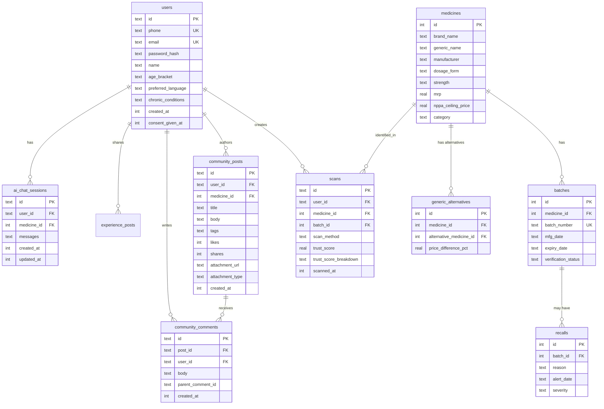

<p align="center">
  
</p>

<h1 align="center">💊 MedSathi — Your Medicine Verification Companion</h1>

<p align="center">
  <em>Scan. Verify. Save. Stay Safe.</em>
</p>

<p align="center">
  
  
  
  
  
  
  
</p>

---

## 📖 Overview

**MedSathi** (Medicine + Saathi/Companion) is a mobile-first web application that empowers Indian consumers to verify medicine authenticity, check for counterfeits, compare prices against NPPA ceiling rates, and discover affordable **Jan Aushadhi (PMBJP)** generic alternatives — all by simply scanning a medicine strip with their phone camera.

### The Problem

- **25%** of medicines sold in developing countries are counterfeit (WHO)
- Consumers have no easy way to verify if their medicines are genuine
- Most people don't know about affordable generic alternatives under the **Pradhan Mantri Bhartiya Janaushadhi Pariyojana (PMBJP)**
- Price overcharging above NPPA ceiling prices is rampant

### The Solution

MedSathi combines **AI-powered image scanning** (Google Gemini), a **verified medicine database** of 560+ medicines, and a **community platform** to give users a one-stop medicine safety companion.

---

## ✨ Features

### 🔍 Medicine Scanning & Verification
- **Camera Scan** — Point your phone camera at a medicine strip; Gemini AI extracts all details
- **Image Upload** — Upload a photo of the medicine strip for scanning
- **QR/Barcode Scan** — Scan barcodes printed on medicine packaging
- **5-Point Authenticity Check** — Batch verification, expiry validation, manufacturer check, NPPA price compliance, and recall status
- **Company Verification** — Cross-checks manufacturer against 45+ verified Indian pharmaceutical companies
- **Trust Score** — Overall genuineness score based on multiple verification signals

### 💰 Jan Aushadhi Generic Alternatives
- **Side-by-side Comparison** — See your medicine vs. the Jan Aushadhi generic equivalent
- **Savings Calculator** — Instantly shows how much you can save (e.g., ₹42.50 → ₹8.00, save 81%)
- **57 Jan Aushadhi Alternatives** — Pre-loaded alternatives for common branded medicines
- **PMBJP Information** — Learn about the government's generic medicine program

### 🏥 Community (YouTube-style Health Forum)
- **Create Posts** — Share health experiences, medicine reviews, disease management tips
- **Like & Share** — Engage with posts from other community members
- **Comment System** — Threaded comments with reply support
- **Tags & Categories** — Filter posts by health condition tags
- **Media Attachments** — Attach images or files to posts
- **16 Pre-seeded Posts** — Active community from day one with real health discussions

### 🤖 AI Chat Assistant
- **Medicine Q&A** — Ask anything about medicines, dosages, side effects, interactions
- **Powered by Gemini AI** — Intelligent responses with medical context
- **Chat History** — Conversations are saved per user
- **Bilingual Support** — Ask questions in English or Hindi

### 🔐 Authentication System
- **Email/Password Registration** — Secure signup with SHA-256 hashing
- **JWT-based Sessions** — Stateless authentication with token refresh
- **WhatsApp OTP** — Forgot password flow with OTP via WhatsApp
- **Profile Setup** — Age bracket, preferred language, chronic conditions
- **Privacy Consent** — Explicit consent collection before data processing

### 🌐 Bilingual (EN/HI)
- Full English and Hindi language support
- One-tap language toggle accessible from every screen

---

## 🛠️ Tech Stack

| Layer | Technology |
|-------|-----------|
| **Frontend** | React 19, Vite 8, TypeScript 6, Tailwind CSS 4 |
| **Backend** | Express 5, TypeScript 5, Node.js |
| **Database** | SQLite (via better-sqlite3), Drizzle ORM |
| **AI/ML** | Google Gemini 3.5 Flash (`@google/generative-ai`) |
| **Auth** | JWT (jsonwebtoken), SHA-256 password hashing |
| **File Upload** | Multer (10MB limit, images only) |
| **State Mgmt** | TanStack React Query, React Context |
| **Routing** | React Router v7 |
| **Icons** | Lucide React |
| **Deployment** | Vercel (Serverless) |

---

## 📁 Project Structure

```
Med-Sathi/
├── client/                          # React Frontend
│   ├── public/
│   │   ├── favicon.svg              # App icon
│   │   ├── icons.svg                # SVG icon sprite
│   │   ├── manifest.json            # PWA manifest
│   │   └── sw.js                    # Service worker
│   ├── src/
│   │   ├── api/
│   │   │   └── client.ts            # Axios-like fetch wrapper
│   │   ├── components/
│   │   │   ├── BottomNav.tsx         # Mobile bottom navigation
│   │   │   ├── Disclaimer.tsx        # Medical disclaimer banner
│   │   │   ├── EmptyState.tsx        # Empty state placeholder
│   │   │   ├── LanguageToggle.tsx    # EN/HI language switcher
│   │   │   ├── LoadingSequence.tsx   # Animated scanning loader
│   │   │   ├── MedicineCard.tsx      # Medicine info card
│   │   │   ├── PriceComparison.tsx   # Price comparison widget
│   │   │   ├── RecallBanner.tsx      # Medicine recall alert
│   │   │   └── TrustBadge.tsx        # Trust score badge
│   │   ├── hooks/
│   │   │   └── useAuth.tsx           # Auth context & hooks
│   │   ├── i18n/
│   │   │   ├── en.json               # English translations
│   │   │   ├── hi.json               # Hindi translations
│   │   │   └── I18nProvider.tsx       # i18n context provider
│   │   ├── pages/
│   │   │   ├── Chat.tsx              # AI chat assistant
│   │   │   ├── Community.tsx         # Community forum
│   │   │   ├── Consent.tsx           # Privacy consent screen
│   │   │   ├── ForgotPassword.tsx    # Password recovery
│   │   │   ├── Home.tsx              # Home dashboard
│   │   │   ├── Login.tsx             # Login screen
│   │   │   ├── OtpVerify.tsx         # OTP verification
│   │   │   ├── Profile.tsx           # User profile
│   │   │   ├── ProfileSetup.tsx      # Onboarding profile setup
│   │   │   ├── Register.tsx          # Registration screen
│   │   │   ├── Results.tsx           # Scan results & verification
│   │   │   ├── Scan.tsx              # Camera/upload scanner
│   │   │   └── Splash.tsx            # Splash/landing screen
│   │   ├── types/
│   │   │   └── index.ts             # TypeScript type definitions
│   │   ├── App.tsx                   # Root app with routing
│   │   ├── index.css                 # Global styles (Tailwind)
│   │   ├── main.tsx                  # Entry point
│   │   └── vite-env.d.ts            # Vite type declarations
│   ├── index.html
│   ├── package.json
│   ├── tsconfig.json
│   ├── vercel.json                   # Vercel SPA rewrite config
│   └── vite.config.ts
│
├── server/                           # Express Backend
│   ├── api/
│   │   └── index.ts                  # Vercel serverless entry
│   ├── src/
│   │   ├── db/
│   │   │   ├── index.ts              # DB connection + auto-seed
│   │   │   ├── schema.ts             # Drizzle ORM schema (10 tables)
│   │   │   ├── seed.ts               # Manual seed script
│   │   │   ├── seed-data.json        # 560 medicines, 300 batches, 57 alternatives
│   │   │   ├── medicines-data.ts     # Medicine data helpers
│   │   │   └── generate-seed.js      # Seed data generator
│   │   ├── middleware/
│   │   │   └── auth.ts               # JWT authentication middleware
│   │   ├── providers/
│   │   │   ├── AIChatProvider.ts      # Gemini AI chat integration
│   │   │   ├── DataProvider.ts        # Data access layer
│   │   │   ├── ImageScanProvider.ts   # Gemini image scanning
│   │   │   └── StorageProvider.ts     # File storage abstraction
│   │   ├── routes/
│   │   │   ├── auth.ts               # Auth routes (register, login, OTP)
│   │   │   ├── chat.ts               # AI chat routes
│   │   │   ├── community.ts          # Community posts & comments
│   │   │   ├── experiences.ts        # Experience posts
│   │   │   ├── medicines.ts          # Medicine lookup routes
│   │   │   └── scan.ts               # Medicine scanning routes
│   │   ├── utils/
│   │   │   ├── otp.ts                # OTP generation & WhatsApp sending
│   │   │   └── runtimePaths.ts       # Platform-aware file paths
│   │   ├── app.ts                    # Express app setup & CORS
│   │   └── index.ts                  # Local dev server entry
│   ├── drizzle.config.ts
│   ├── package.json
│   ├── tsconfig.json
│   └── vercel.json                   # Vercel serverless config
│
├── VERCEL_DEPLOYMENT.md              # Deployment guide
└── README.md                         # This file
```

---

## 🗄️ Database Schema

The app uses **SQLite** with **Drizzle ORM** and includes **10 tables**:



### Pre-loaded Data

| Data Type | Count |
|-----------|-------|
| Medicines | **560** |
| Batches | **300** |
| Jan Aushadhi Alternatives | **57** |
| Demo Community Posts | **16** |
| Demo Comments | **10+** |

---

## 🚀 Getting Started

### Prerequisites

- **Node.js** ≥ 18.x
- **npm** ≥ 9.x
- **Google Gemini API Key** — [Get one here](https://aistudio.google.com/apikey)

### 1. Clone the Repository

```bash
git clone https://github.com/<your-username>/Med-Sathi.git
cd Med-Sathi
```

### 2. Setup Backend

```bash
cd server
npm install
```

Create a `.env` file in the `server/` directory:

```env
GEMINI_API_KEY=your_gemini_api_key_here
JWT_SECRET=your_super_secret_jwt_key
PORT=3000
```

Seed the database (optional — auto-seeds on first run):

```bash
npm run seed
```

Start the development server:

```bash
npm run dev
```

The API will be running at `http://localhost:3000`.

Verify: `http://localhost:3000/health` → `{"status":"ok"}`

### 3. Setup Frontend

Open a **new terminal**:

```bash
cd client
npm install
```

Create a `.env` file in the `client/` directory (optional, defaults to localhost):

```env
VITE_API_URL=http://localhost:3000/api
```

Start the development server:

```bash
npm run dev
```

The app will be running at `http://localhost:5173`.

---

## 📡 API Endpoints

### Authentication

| Method | Endpoint | Description | Auth |
|--------|----------|-------------|------|
| `POST` | `/api/auth/register` | Register with email, phone, password | ❌ |
| `POST` | `/api/auth/login` | Login with email & password | ❌ |
| `POST` | `/api/auth/forgot-password` | Send OTP to WhatsApp | ❌ |
| `POST` | `/api/auth/verify-otp` | Verify OTP & reset password | ❌ |
| `GET`  | `/api/auth/me` | Get current user profile | ✅ |
| `PUT`  | `/api/auth/profile` | Update user profile | ✅ |

### Medicine Scanning

| Method | Endpoint | Description | Auth |
|--------|----------|-------------|------|
| `POST` | `/api/scan` | Scan medicine (barcode data) | ✅ |
| `POST` | `/api/scan/image` | Scan medicine strip image (multipart) | ✅ |
| `GET`  | `/api/scan/:id` | Get scan result details | ✅ |

### Medicines

| Method | Endpoint | Description | Auth |
|--------|----------|-------------|------|
| `GET`  | `/api/medicines` | List all medicines | ✅ |
| `GET`  | `/api/medicines/:id` | Get medicine details | ✅ |
| `GET`  | `/api/medicines/:id/alternatives` | Get generic alternatives | ✅ |

### Community

| Method | Endpoint | Description | Auth |
|--------|----------|-------------|------|
| `GET`  | `/api/community/posts` | List all community posts | ✅ |
| `POST` | `/api/community/posts` | Create a new post | ✅ |
| `GET`  | `/api/community/posts/:id` | Get post details | ✅ |
| `POST` | `/api/community/posts/:id/like` | Like a post | ✅ |
| `POST` | `/api/community/posts/:id/share` | Share a post | ✅ |
| `GET`  | `/api/community/posts/:id/comments` | Get post comments | ✅ |
| `POST` | `/api/community/posts/:id/comments` | Add a comment | ✅ |

### AI Chat

| Method | Endpoint | Description | Auth |
|--------|----------|-------------|------|
| `POST` | `/api/chat` | Send a message to AI assistant | ✅ |
| `GET`  | `/api/chat/sessions` | Get chat history | ✅ |

### Health Check

| Method | Endpoint | Description | Auth |
|--------|----------|-------------|------|
| `GET`  | `/health` | Server health check | ❌ |
| `GET`  | `/` | Server info | ❌ |

---

## 🌍 Deployment (Vercel)

MedSathi is deployed as **two separate Vercel projects** (frontend + backend).

### Backend Deployment

1. Import the repository on Vercel
2. Set **Root Directory** to `server`
3. Add environment variables:
   | Variable | Value |
   |----------|-------|
   | `GEMINI_API_KEY` | Your Gemini API key |
   | `JWT_SECRET` | A strong random secret |
   | `CLIENT_ORIGIN` | Your frontend URL (e.g., `https://med-sathi.vercel.app`) |
4. Deploy — the `server/vercel.json` config handles serverless routing
5. Verify: `https://<backend-url>/health` → `{"status":"ok"}`

### Frontend Deployment

1. Import the same repository on Vercel (as a new project)
2. Set **Root Directory** to `client`
3. Add environment variables:
   | Variable | Value |
   |----------|-------|
   | `VITE_API_URL` | `https://<backend-url>/api` |
4. Deploy

### Important Notes

> ⚠️ **Ephemeral Filesystem**: Vercel serverless functions use ephemeral `/tmp` storage. The SQLite database is recreated and auto-seeded on every cold start. For production, migrate to a hosted database (e.g., Turso, PlanetScale, Neon).

> ⚠️ **File Uploads**: Uploaded images are stored on the ephemeral filesystem and won't persist. For production, use Vercel Blob or S3-compatible storage.

---

## 📱 App Screenshots & User Flow

```
┌─────────┐    ┌─────────┐    ┌──────────┐    ┌──────────┐
│  Splash  │───▶│  Login   │───▶│  Home    │───▶│  Scan    │
│  Screen  │    │ Register │    │Dashboard │    │ Camera/  │
│          │    │          │    │          │    │ Upload   │
└─────────┘    └─────────┘    └──────────┘    └──────────┘
                                                     │
                                                     ▼
┌─────────┐    ┌──────────┐    ┌──────────┐    ┌──────────┐
│ Profile  │    │   AI     │    │Community │    │ Results  │
│  Page    │    │  Chat    │    │  Forum   │    │Verify +  │
│          │    │Assistant │    │Posts/Like │    │Jan Aushadhi│
└─────────┘    └──────────┘    └──────────┘    └──────────┘
```

### User Flow

1. **Splash** → Animated landing with app branding
2. **Register/Login** → Email + password authentication
3. **Profile Setup** → Age, language, chronic conditions
4. **Consent** → Privacy consent before data processing
5. **Home** → Dashboard with quick scan button and recent activity
6. **Scan** → Camera or upload a medicine strip photo
7. **Results** → Full verification report:
   - ✅ Company verification (45+ verified pharma companies)
   - ✅ Batch number validation
   - ✅ Expiry date check
   - ✅ NPPA price compliance
   - ✅ Recall status check
   - 💊 Jan Aushadhi alternative with savings comparison
8. **Community** → Browse/create health posts, like, comment, share
9. **AI Chat** → Ask medicine questions to Gemini AI
10. **Profile** → View/edit profile, language toggle, logout

---

## 🔑 Environment Variables

### Server (`server/.env`)

| Variable | Required | Default | Description |
|----------|----------|---------|-------------|
| `GEMINI_API_KEY` | ✅ Yes | — | Google Gemini API key for AI scanning & chat |
| `JWT_SECRET` | ⚠️ Recommended | `aslee-dev-secret-change-in-production` | Secret key for JWT token signing |
| `PORT` | No | `3000` | Server port |
| `CLIENT_ORIGIN` | No | — | Comma-separated allowed CORS origins |

### Client (`client/.env`)

| Variable | Required | Default | Description |
|----------|----------|---------|-------------|
| `VITE_API_URL` | No | `http://localhost:3000/api` | Backend API base URL |

---

## 🔒 Security

- **Password Hashing** — SHA-256 with application salt (upgrade to bcrypt for production)
- **JWT Authentication** — Stateless token-based auth on all protected routes
- **CORS Protection** — Whitelist-based origin validation with regex for Vercel previews
- **Input Validation** — Request validation on all API endpoints
- **File Upload Limits** — 10MB max, image-only MIME type filtering
- **Sensitive Data Stripping** — `sanitizeUser()` removes `password_hash` from all API responses
- **OTP Expiry** — Time-limited OTP codes for password reset

---

## 🧪 Development

### Commands

**Backend:**

```bash
cd server
npm run dev          # Start dev server with hot reload (tsx watch)
npm run build        # Compile TypeScript
npm run seed         # Seed database manually
npm start            # Start production server
```

**Frontend:**

```bash
cd client
npm run dev          # Start Vite dev server
npm run build        # Build for production (tsc + vite build)
npm run preview      # Preview production build
```

### Type Checking

```bash
# Backend
cd server && npx tsc --noEmit

# Frontend
cd client && npx tsc --noEmit
```

---

## 🤝 Contributing

Contributions are welcome! Here's how you can help:

1. **Fork** the repository
2. **Create** a feature branch (`git checkout -b feature/amazing-feature`)
3. **Commit** your changes (`git commit -m 'feat: add amazing feature'`)
4. **Push** to the branch (`git push origin feature/amazing-feature`)
5. **Open** a Pull Request

### Areas for Contribution

- [ ] Migrate SQLite → hosted database (Turso/PlanetScale) for production persistence
- [ ] Replace local file storage with Vercel Blob / S3
- [ ] Add bcrypt for password hashing (replace SHA-256)
- [ ] Implement real WhatsApp OTP via Twilio/WhatsApp Business API
- [ ] Add medicine image recognition (identify pills from photos)
- [ ] Push notifications for recall alerts
- [ ] Offline mode with service worker caching
- [ ] Unit & integration test suite
- [ ] CDSCO API integration for real-time verification

---

## 📄 License

This project is licensed under the **MIT License** — see the [LICENSE](LICENSE) file for details.

---

## 🙏 Acknowledgements

- **[Pradhan Mantri Bhartiya Janaushadhi Pariyojana (PMBJP)](http://janaushadhi.gov.in/)** — India's affordable generic medicine program
- **[NPPA (National Pharmaceutical Pricing Authority)](https://www.nppaindia.nic.in/)** — Drug price ceiling data
- **[CDSCO](https://cdsco.gov.in/)** — Central Drugs Standard Control Organisation
- **[Google Gemini AI](https://ai.google.dev/)** — AI-powered medicine scanning and chat
- **[Drizzle ORM](https://orm.drizzle.team/)** — Type-safe SQL toolkit
- **[Lucide Icons](https://lucide.dev/)** — Beautiful open-source icons

---

<p align="center">
  Made with ❤️ in India for safer, affordable healthcare 🇮🇳
</p>
